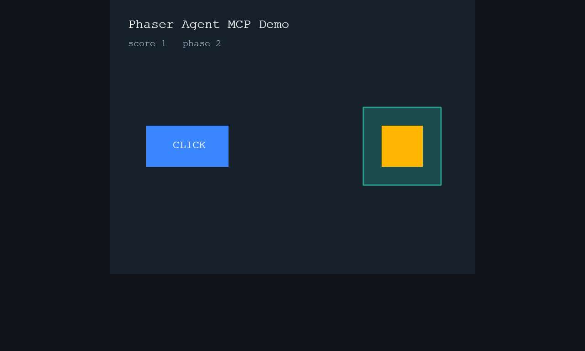
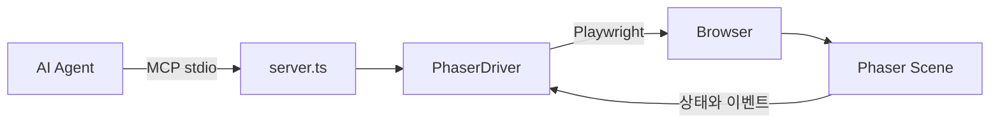

# Canvas Agent MCP

Canvas 안의 Phaser 게임을 AI 에이전트가 **직접 실행하고, 조작하고, 검증**하게 해 주는 MCP 서버입니다.



## 만든 이유?

Canvas 내부는 DOM이 아니라서 일반 브라우저 도구로는 버튼도 상태도 보이지 않습니다. 그래서 에이전트가 코드를 고치더라도, 사람이 직접 매번 확인했어야 했습니다.
로블록스 게임을 만들면서 play->stop을 Agent가 직접 제어했을 때 생산성이 향상되었었고 정확도도 높았어서 그에 감명을 받아 개발하게 되었습니다.

이 서버는 Phaser 씬에 접근해 **게임이 실제로 어떤 상태인지**를 에이전트에게 알려 줍니다. 스크린샷으로 화면을 판단하는 대신 Phaser 씬에 직접 접근해 상태와 이벤트를 조회하여 Agent가 구현과 검증을 스스로 반복할 수 있습니다.

## 도구

| 도구 | 하는 일 |
|---|---|
| `play` | 게임 실행 (창 표시 또는 headless) |
| `stop` | 게임 종료 |
| `get_state` | 입력 가능 여부, 재생 중인 소리, 설정한 게임 값 조회 |
| `list_targets` | 지금 누를 수 있는 오브젝트와 좌표 조회 |
| `click` | 오브젝트 클릭 |
| `drag` | 오브젝트를 특정 좌표로 드래그 |
| `timeline` | 메서드 호출, 입력, 소리를 시간순으로 조회 |
| `screenshot` | 화면 캡처 (토큰이 많이 드는 최후의 수단) |

## 구조



## 빠른 시작

```bash
npm install
npx playwright install chromium
npm run demo
```

다른 터미널에서 Claude Code에 등록합니다. 경로는 저장소의 절대 경로로 바꾸세요.

```bash
claude mcp add phaser-agent \
  -e PHASER_AGENT_CONFIG=/absolute/path/phaser-agent.config.json \
  -- node /absolute/path/node_modules/tsx/dist/cli.mjs /absolute/path/src/server.ts
```

이제 에이전트에게 이렇게 요청할 수 있습니다.

> 게임을 실행해서 버튼을 클릭하고, 블록을 목표 지점으로 드래그한 뒤 점수와 단계가 바뀌었는지 확인해 줘.

## 내 게임에 연결하기

게임 인스턴스를 전역에 노출합니다.

```ts
window.__game = new Phaser.Game(config);
```

`phaser-agent.config.json`에 게임 구조를 적습니다. 경로는 씬을 기준으로 하고, 끝에 `()`를 붙이면 메서드를 호출합니다.

```json
{
  "url": "http://localhost:5173",
  "gameGlobal": "__game",
  "scene": "Main",
  "readyPath": "controller.ready",
  "state": {
    "score": "controller.score",
    "timerLeftMs": "controller.timer.getRemaining()"
  },
  "trace": [
    { "target": "controller", "method": "addScore", "event": "score_add" }
  ],
  "events": [
    { "target": "controller", "name": "GAME_COMPLETE", "event": "complete" }
  ]
}
```

| 항목 | 설명 |
|---|---|
| `scene` | 검사할 씬의 키 |
| `readyPath` | 값이 참이 되면 게임 준비가 끝난 것으로 판단 (선택) |
| `state` | `get_state`로 볼 값의 이름과 경로 |
| `trace` | 호출을 기록할 메서드 |
| `events` | 기록할 이벤트 |

## 설계 강점

- **조용히 실패하지 않습니다.** 메서드 이름이 바뀌어 추적할 수 없으면 `play` 결과의 `missing`으로 알려 줍니다. 이벤트가 없는 것과 기록이 안 된 것을 에이전트가 구분할 수 있습니다.
- **입력 및 잠금 값을 반환합니다.** `click`과 `drag`는 조작 시점의 `inputEnabled`를 함께 반환하여 무시된 입력을 성공으로 착각하지 않게 합니다.
- **토큰을 아낍니다.** 대부분은 작은 JSON 조회로 확인하고, 스크린샷은 눈으로 봐야 할 때만 쓰도록 도구 설명에 명시했습니다.
- **화면 크기가 달라도 맞습니다.** Canvas가 확대·축소되어 있어도 게임 좌표를 화면 좌표로 변환합니다.

## 테스트

```bash
npm test
```
